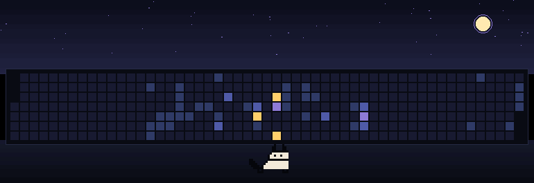

**One square per day, one column per week.** Yesterday's activity picks the sky.

<details>
<summary>How it works, and how to redraw it</summary>

## What the picture is

`out/daily.gif` is drawn from scratch at 00:17 UTC every night by
[`.github/workflows/daily.yml`](.github/workflows/daily.yml) and committed only
if it changed.

| In the picture | Comes from |
| --- | --- |
| 53 × 7 grid of squares | your contribution calendar, Sunday-first columns |
| Square colour | that day's activity level (0–4), `art/palette.json` → `levels` |
| Sky gradient | how busy yesterday was: quiet / low / steady / blazing |
| Moon size, star field | seeded by the date |
| Cat, walk cycle | `art/creature.txt` |

Days still in the future are left blank, so the graph fills in as the year goes.

## Run it locally

```sh
python3 -m venv .venv && .venv/bin/pip install -r requirements.txt

.venv/bin/python src/collect.py --login suzukiven0m --out out/activity.json
.venv/bin/python src/render.py --data out/activity.json
```

`collect.py` picks up a token from `GH_TOKEN`/`GITHUB_TOKEN`, or from
`gh auth token` if you are logged in to the GitHub CLI. `render.py` writes
`out/daily.gif`; add `--preview out/still.png` for a single frame.

To try a change without waiting a day, fake the date:

```sh
.venv/bin/python src/collect.py --login suzukiven0m --out out/activity.json --today 2026-06-01
```

## Change the art

Both files in `art/` are plain text and need no code changes.

`art/creature.txt` is a sprite sheet: one character per pixel, `.` transparent,
frames separated by `---` lines, `#` for comments. The characters map to colours
in `art/palette.json` → `chars`. Any number of frames works, and they drive the
walk cycle directly.

`art/palette.json` holds every colour in the scene, including the five activity
levels, the four skies, and the card the squares sit on.

After editing either file, check it renders and stays README-sized:

```sh
.venv/bin/python src/render.py --check
```

## Traps this already handles

- **Bot commits do not count as contributions.** The nightly commit is made by
  `github-actions[bot]`, so it never inflates the graph it draws.
- **GitHub disables scheduled workflows after 60 days without repository
  activity.** The star field and moon are seeded by the date, so the GIF differs
  every night and the commit keeps the schedule alive even through a long quiet
  stretch. `render.py --check` fails if two different days ever render
  byte-identically, so this cannot silently regress.
- **Cron is best-effort.** GitHub can start a scheduled run 5–60 minutes late;
  only "after 00:00 UTC" matters.
- **Private contributions.** A plain `GITHUB_TOKEN` sees public activity only.
  Add a personal access token as the `ACTIVITY_TOKEN` secret to include private
  contributions.
- **GIF size.** Over 3 MB and `render.py` refuses to write, rather than publish
  something a README browser will not load.
- **Concurrent runs** are serialized by the workflow `concurrency` group, and the
  commit step rebases before pushing.
- **Pinned actions.** Checkout and setup-python are pinned to commits, since this
  job runs with `contents: write`.

If the schedule ever does get disabled, re-enable it from the Actions tab or with
`gh workflow enable daily.yml`.

</details>
